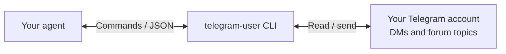

# Telegram User CLI

Let your agent read and send messages through your own Telegram account.

`telegram-user` is a standalone command line tool built on [Telethon](https://docs.telethon.dev).
It works with any agent that can run shell commands. No OpenClaw gateway or background
service is required. Operations return JSON, including message IDs for readback and replies.



## Install

Python 3.10 or later. macOS and Linux are the initial supported platforms.

```sh
git clone https://github.com/artemgetmann/telegram-user-cli.git
cd telegram-user-cli
python3 -m venv .venv
.venv/bin/python -m pip install .
.venv/bin/telegram-user --help
```

Or install the tagged release directly into an isolated environment:

```sh
uv tool install 'git+https://github.com/artemgetmann/telegram-user-cli.git@v0.1.0'
```

This release is distributed through GitHub. It is not published on PyPI.

## Connect your account

Create your own API application at [my.telegram.org/apps](https://my.telegram.org/apps).
[Telegram's instructions](https://core.telegram.org/api/obtaining_api_id) explain the API ID
and hash. These are application credentials. Login also needs your Telegram phone number,
the code Telegram sends you, and your 2FA password if enabled.

```sh
cp .env.example .env
chmod 600 .env
# Fill in TELEGRAM_API_ID and TELEGRAM_API_HASH in .env with your editor.
.venv/bin/telegram-user --env-file .env doctor
.venv/bin/telegram-user --env-file .env login --phone '+15550000000'
.venv/bin/telegram-user --env-file .env status --json
```

On a terminal, login prompts privately for the code and 2FA password. For staged agent
login, use `login --phone ... --secret-stdin code` or `--secret-stdin password` and supply
that one secret through stdin. A noninteractive login without a secret returns the
current `awaiting_code` or `awaiting_password` state.

Credentials can also be supplied through environment variables. Environment values win
over an explicitly selected env file. The CLI never auto-loads a nearby `.env` or adopts
credentials from another application.

The default session lives at `~/.local/share/telegram-user/user.session`, or under
`$XDG_DATA_HOME/telegram-user/`. Set `--session /absolute/path/account.session` or
`TELEGRAM_USER_SESSION` for a separate account. Session access is serialized by a lock.

## Use it

Examples assume `telegram-user` is on PATH and credentials are in your environment.
With the local virtual environment, use `.venv/bin/telegram-user --env-file .env` instead.

```sh
# Discover dialogs, then read one exact chat.
telegram-user inbox --unread --dm-only --limit 10
telegram-user read --chat @username --limit 5

# Start with Saved Messages, Telegram's chat with yourself.
telegram-user send --chat me --message 'hello from the terminal'
telegram-user read --chat me --limit 1

# Send exact generated text, including whitespace and literal backslashes.
telegram-user send --chat @username --message-file /path/to/message.txt
printf '%s' 'hello from my agent' | telegram-user send --chat me --message-file -

# Reply to a message ID returned by read.
telegram-user send --chat @username --reply-to 123 --message 'got it'

# Filter history or wait for a new inbound reply.
telegram-user read --chat @username --contains invoice --after-id 123
telegram-user wait --chat @username --after-id 123 --timeout 60

# Upload a document with an exact caption.
telegram-user send --chat me --media /path/to/document.pdf --caption-file /path/to/caption.txt

# Resolve a forum topic title, then use its returned topic_anchor.
telegram-user topic-resolve --chat=-1001234567890 --title 'Development'
telegram-user read --chat=-1001234567890 --topic-anchor 456 --limit 10
telegram-user send --chat=-1001234567890 --topic-anchor 456 --message 'hello topic'
```

Other commands: `precheck`, `topic-create`, `topic-delete`, `mark-read`, `mark-unread`,
`download`, `button-click`, and `logout`. Use `<command> --help` for exact arguments.
`skill` prints the bundled agent instructions. `doctor` checks local setup without
network access; `status` checks actual authentication with Telegram.

## Connect an agent

Give your agent the output of `telegram-user skill`, or the bundled
[SKILL.md](src/telegram_user_cli/SKILL.md). The basic workflow is:
resolve the intended recipient, read the relevant chat, prepare exact text in a file,
get the account owner's authorization, send once, and read back the returned message ID.

Agents should use `--message-file` and `--caption-file`. Inline text is a convenience
for simple human input and rejects ambiguous multiline or backslash content.

For a runnable, account-free demonstration of that workflow:

```sh
.venv/bin/python examples/demo.py
```

The demo uses synthetic messages and clearly labels its transport fixture. It does
not connect to Telegram and is not evidence of live message delivery.
An [asciinema replay](examples/demo.cast) of the same fixture output is also included.

## Output and failure behavior

Success is one JSON record on stdout. Errors are JSON on stderr with a nonzero exit.
`--json` is accepted for clarity, but JSON is already the default. The `skill` command
prints Markdown instead. `--rpc-timeout` bounds each operation; `wait --timeout` bounds
the overall wait. `wait` returns `matched: false, timed_out: true` when no reply arrives.

Reading history does not mark it read. `mark-read` is explicit; a successful send
also acknowledges the dialog. An acknowledgement failure after sending is reported
as uncertain delivery. Read the exact target before deciding whether to retry.

A timeout or connection failure can happen after Telegram accepts a mutation.
The CLI does not automatically retry requests. Never blindly retry a send, topic
creation, or button action. Inspect the target first.

## Account security

Keep API hashes, login codes, passwords, and `.session` files private. A session file
grants account access. Use your own account with the owner's permission, respect
[Telegram's API terms](https://core.telegram.org/api/terms), and do not use this for spam.
`logout` clears only this CLI's selected local session artifacts. To revoke a remote
authorization, use Telegram Settings → Devices.

## Development

```sh
python3 -m venv .venv
.venv/bin/python -m pip install -r requirements-dev.txt
.venv/bin/python -m pip install --no-deps -e .
.venv/bin/ruff check src tests
.venv/bin/python -m unittest discover -s tests -v
.venv/bin/python -m build --no-isolation
```

Tests use fake clients and temporary sessions. They never message real contacts.
See [architecture](docs/architecture/overview.md) for ownership and proof boundaries.

## License and provenance

MIT. The transport was extracted from the Telegram user tooling in a local OpenClaw
fork, then adapted for standalone installation and account storage. Telethon owns
the protocol implementation. Original MIT attribution is retained in [LICENSE](LICENSE).
See [PROVENANCE.md](PROVENANCE.md).
